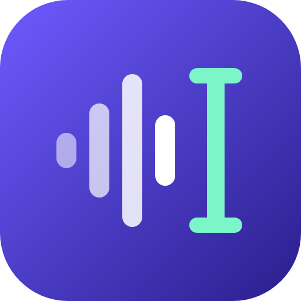

<p align="center"></p>

# Hushtype

Hold a key, speak, let go, and polished text appears in whatever app has focus. An open,
privacy-first alternative to Wispr Flow, built as a native macOS app in Swift and SwiftUI.

## What it does

- **Push-to-talk** on Right Option (default), Right Command, or Fn/🌐, captured system-wide with a `CGEventTap`.
  Pressing any other key while holding cancels, so normal shortcuts keep working.
- **Hands-free**: double-tap the key and talk as long as you like; tap again to insert, Esc to cancel.
- **Speech to text on this Mac** with Apple's `SpeechAnalyzer`. Audio is transcribed live while you hold the key,
  so the transcript is ready almost as soon as you let go. Free, private, and works offline once the
  voice model for your language has downloaded (setup does this for you).
- **Cleanup** with Claude Haiku, streamed: removes fillers, fixes punctuation, applies self-corrections
  ("at 5, no, 6 pm" becomes "at 6 pm"). Short phrases with no fillers or corrections skip Claude entirely, the
  connection is opened while you're still talking, and if Claude hasn't started answering within 2 seconds the
  raw transcript is inserted instead.
- **Context awareness**: the app you're in and the text around the cursor (read through Accessibility, never
  from password fields) go to Claude, so it matches tone (casual in Slack, careful in Mail, literal in editors),
  continues your sentence, and spells names already on screen. Those names also help the transcriber.
- **Command mode**: select text, hold the key, press Control too, and say "make this shorter" or "translate to
  Hindi". The result replaces the selection. With nothing selected, Claude writes what you ask for.
- **Personal dictionary** fed to both the speech engine and Claude, and it **learns from your corrections**: fix
  the spelling of a name right after dictating it and Hushtype remembers it.
- **Snippets**: say "my calendar link" and the full text is typed.
- **History** saved on your Mac, searchable in Settings, and **⌃⌘V** pastes the last dictation again.
- **Speed readout**: Settings › Claude shows typical and 90th-percentile time from letting go to text.
- **Auto-updates** with Sparkle in signed releases (see [RELEASING.md](RELEASING.md)).

## Build and run

Requires macOS 26+ and Xcode 26 (or the Swift 6.2+ toolchain). The only key you need is an Anthropic API key.

```sh
scripts/build-app.sh          # builds dist/Hushtype.app
open dist/Hushtype.app
```

You can also open `Package.swift` in Xcode to edit and debug, but permissions such as the microphone need the
bundled app from the script, since a bare executable has no `Info.plist`.

On first launch a short guided setup walks through **Microphone**, **Input Monitoring** and **Accessibility** (each
step notices the grant by itself and moves on, and restarts Hushtype for you when macOS requires it), checks your
downloads the on-device voice model, checks your Anthropic key as you paste it, and ends with a practice field to try your first dictation.
Run it again any time from Settings › General.

macOS ties Accessibility and Input Monitoring grants to the code signature, and the default ad-hoc signature changes
with every build. To keep grants across rebuilds, create a self-signed code-signing certificate in Keychain Access
and build with `HUSHTYPE_SIGN_IDENTITY="Your Cert Name" scripts/build-app.sh`.

## Layout

```
Sources/HushtypeCore/   pipeline logic: on-device speech-to-text, Claude cleanup (unit tested)
Sources/Hushtype/       the menu bar app: hotkey, recorder, overlay, paste, settings, Keychain
Tests/                  HushtypeCore tests (swift test)
Resources/Info.plist    app bundle metadata (LSUIElement, mic usage string)
scripts/build-app.sh    builds, icons and signs dist/Hushtype.app
scripts/release.sh      signed, notarized release with DMG and Sparkle appcast (RELEASING.md)
```

## License

MIT
